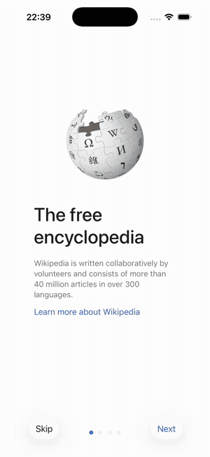

# Tamam

**The AI QA tester that proves every pass.**

Write a test in plain English. Tamam runs it on an iOS simulator, a real iPhone or a device
farm (AWS Device Farm, BrowserStack, LambdaTest, Sauce Labs) the way a person would — and says
PASS only when it can point to what the screen showed.

<p align="center"></p>

```console
$ tamam run --app Wikipedia.app --bundle org.wikimedia.wikipedia \
    "Search Wikipedia for Ada Lovelace, open the article about the English mathematician,
     and verify it says she was born on 10 December 1815"

PASS — Opened Ada Lovelace article, confirmed born 10 December 1815.
  6 steps · 128 s · $0.07
```

<sub>A real run on the open-source [Wikipedia iOS app](https://github.com/wikimedia/wikipedia-ios), shown 3× faster. Not affiliated with the Wikimedia Foundation; article text CC BY-SA.</sub>

**Why Tamam**

- **No guessed passes.** Every PASS cites the text the screen showed for each part of the test.
  If it can't prove something, the run is *inconclusive*, never a pass. Measured: 0 false passes
  in 402 runs on an app with planted bugs.
- **Checks in code before AI.** Whatever can be checked deterministically is; a model only
  judges what rules can't. Tests that claim something the app doesn't do are caught.
- **Plain English.** No selectors, no scripts, no test IDs added to your app.
- **Faster and cheaper over time.** A passing test can become a replay: seconds instead of a
  minute, and no AI cost. The AI steps back in only when the app changes.
  See [fast replay](docs/guide/test-graduation.md).
- **Runs where your app runs.** Simulators, real devices and device farms; open source, on
  your own machine.

iOS today. **Web and Android are coming.**

## Quick start

You need a Mac with Apple Silicon, Homebrew, Xcode with an iOS Simulator runtime installed
(Xcode › Settings › Components) and an Anthropic API key. From there it takes about 10 minutes;
a test run costs roughly $0.10–0.15 in API usage.

```bash
brew install uv node tesseract   # tesseract: local OCR for text the accessibility tree hides
npm install -g appium && appium driver install xcuitest
git clone https://github.com/tamamhq/tamam && cd tamam
./fixtures/ios/build.sh                 # builds Shoply, the demo app with planted bugs
```

In a **second terminal**, start Appium and leave it running:

```bash
appium
```

Back in the first terminal:

```bash
cd backend && uv sync
export ANTHROPIC_API_KEY=sk-ant-...
uv run tamam doctor                                  # checks your setup
uv run tamam run --fixture shoply                    # PASS (the first run also builds Appium's helper app: 1–2 min, once)
uv run tamam run --fixture shoply --buggy            # FAIL: the planted bug is caught
```

Stuck? See [troubleshooting](docs/troubleshooting.md).

## Test your own app

```bash
uv run tamam run --app path/to/YourApp.app --bundle com.you.app \
  "Sign in as demo@example.com with password demo1234, open Settings, and verify Dark mode is off"
```

Use a simulator build of your app (`.app`). [Writing good tests](docs/writing-tests.md) takes two
minutes; [setup](docs/setup.md) covers your own app, real devices and cloud device farms.

## Prefer a dashboard?

The CLI is all you need, but there's also a web dashboard: projects, uploaded builds, saved
tests, a live view of the device during a run, and every run's steps, screenshots, evidence and
verdict. One command each for the API and the UI: see [dashboard](docs/dashboard.md).

## How accurate is it?

Our own test suites, not a third-party benchmark: apps where the right answer is known, each
mixing tests that should pass with planted bugs or false claims that must fail.

| App | Runs | Right verdict | Inconclusive | Wrong verdict |
|---|---|---|---|---|
| Shoply (bundled demo app with planted bugs) | 402 | 99% | 1% | 0 |
| Flutter `form_app` sample | 8 | 8 | 0 | 0 |
| Wikipedia for iOS | 7 | 4 | 3 | 0 |

*Inconclusive* means Tamam couldn't prove the result either way and said so; it never counts
as a pass. One rare false pass is known and listed in [known limits](docs/known-limits.md).
Method and how to reproduce: [results](docs/results.md).

## Learn more

- [How a run works](docs/guide/how-a-run-works.md) · [Verdicts and trust](docs/guide/verdicts-and-trust.md) · [Fast replay](docs/guide/test-graduation.md)
- [Known limits](docs/known-limits.md) · [Dashboard (optional)](docs/dashboard.md) · [Full guide](docs/guide/README.md)

## Status

Early (v0.1). The iOS Simulator path is the most polished; real devices and cloud farms work
but have rougher edges. Issues and pull requests are welcome — see [CONTRIBUTING](CONTRIBUTING.md).

[MIT](LICENSE)
